# De renta en renta

**Housing costs and wages, tract by tract: an atlas shaped like a board game to answer one question. Who has any pay left after paying for housing?**

### → [gastiaso.github.io/de-renta-en-renta](https://gastiaso.github.io/de-renta-en-renta/?idioma=en)

[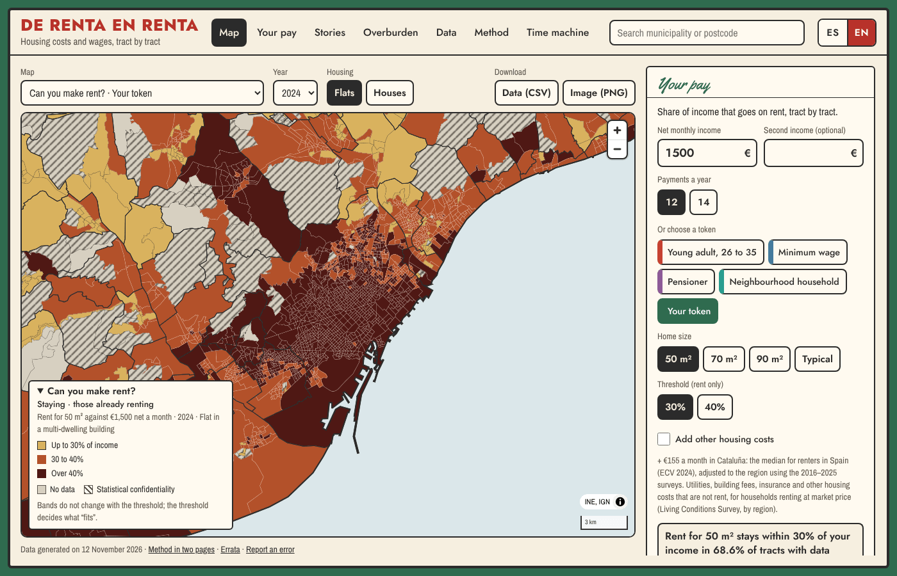](https://gastiaso.github.io/de-renta-en-renta/mapa.html?idioma=en#tu-sueldo)

*De renta en renta, y pago porque me toca* («from rent to rent, and I pay because it's my turn»). The name is left untranslated: it plays on a rhyme from the Spanish Game of the Goose («de oca a oca, y tiro porque me toca»), and *renta* means both rent and income. The atlas sets the two against each other in Spain's 36,333 census tracts, from 2015 to the latest data, with five tokens that change the reference income (a neighbourhood household, a young adult, the minimum wage, a pension and your own income), a time machine going back to 1987 and a European board on housing cost overburden.

| | |
|---|---|
| **Players** | One or more: data journalists, staff of public administrations and organisations, and anyone looking for a flat |
| **Recommended age** | From your first payslip |
| **Playing time** | From one minute («Can you afford it?») to an afternoon (the long table in R, Python or DuckDB) |
| **What you need** | A web browser. Nothing to install, and the income you type never leaves your device |
| **Edition** | v1.2.0, 18 November 2026 ([changelog](CHANGELOG.md), in Spanish) |

> **Board under construction.** Figures, methods and this rulebook are provisional and are revised with each edition. If something does not add up, [let us know](#contact).

## Contents

1. [Object of the game](#1-object-of-the-game)
2. [What's in the box](#2-whats-in-the-box)
3. [The tokens](#3-the-tokens)
4. [Quick game](#4-quick-game)
5. [How to play](#5-how-to-play)
6. [House rules](#6-house-rules)
7. [What the board does not see](#7-what-the-board-does-not-see)
8. [Squares under construction](#8-squares-under-construction)
9. [Playing with the data](#9-playing-with-the-data)
10. [Under the board](#10-under-the-board)
11. [Sources](#11-sources), [how to cite](#how-to-cite), [licences](#licences) and [contact](#contact)

## 1. Object of the game

Find out **where, since when and for whom** the link between housing costs and pay has changed. For those already on the board and for those just joining the game.

One example of what you will find: in 2024, on the minimum wage (€1,237 net a month), the median rent of each tract takes more than 30% of pay in 9 out of 10 tracts with data. With a 50 m² flat, in almost half of them (48.4%).

The game uses two families of figures that **never mix**:

| | **Staying** | **Moving in** |
|---|---|---|
| Who it measures | Those already renting | Those looking for a flat today |
| Source | SERPAVI (Ministry of Housing): current leases declared to the Tax Agency | Portal asking prices; INE index of new leases |
| What the figure is | Median rent of current leases | What listings ask for |
| Scale | Census tract | Municipalities with published listings, and larger areas |
| On the board | Maps, profiles and downloads | Coming soon ([squares under construction](#8-squares-under-construction)) |

## 2. What's in the box

- **1 home board** with 24 squares: 21 lead to a map, a profile or a page (four to «Rules of the game», with provisional summaries); the 3 striped ones are under construction.
- **36,333 map squares**: the 2021 census tracts, with their 8,131 municipalities, 52 provinces and 19 autonomous communities and cities.
- **5 profile tokens**, each with its own income and home.
- **17 maps** in the selector, plus a «Can you afford it?» for each token.
- **24 indicators**, each at the scale its source publishes.
- **4 guided stories**, step by step, inside the map.
- **1 time machine**: national series since 1987.
- **1 European board**: housing cost overburden, with the Eurostat method.
- **1 long table** in Parquet with every figure that passes the validation gate.

<details>
<summary><b>The 24 indicators</b></summary>

| # | Indicator | Finest scale | Years | Where to see it |
|---|---|---|---|---|
| 1 | Average net income per person | Tract | 2015–2024 | Map |
| 2 | Average net income per household | Tract | 2015–2024 | Map |
| 3 | Median income per consumption unit | Tract | 2015–2024 | Map |
| 4 | Share of wages in income | Tract | 2015–2024 | Map |
| 5 | Population below 60% of median income per consumption unit | Tract | 2015–2024 | Map |
| 6 | Gini index | Tract | 2015–2024 | Map |
| 7 | Average annual wage per employee (total and aged 26 to 35) | Province | 2011–2025 | Tokens and wage percentile |
| 8 | Monthly rent (median) | Tract | 2015–2024 | Map |
| 9 | Rent per square metre | Tract | 2015–2024 | Map |
| 10 | Annual change in rents | District of provincial capitals | 2015–2024 | Map |
| 11 | Sale price per square metre | Province | 2015–2025 | Map |
| 12 | Appraised value per square metre | Municipality over 25,000 inhabitants | 2015–2025 | Map |
| 13 | Asking price (rent and sale) | Municipality and portal area | — | Coming soon |
| 14 | Median rent over the area's average household income | Tract | 2015–2024 | Profile |
| 15 | Rent share of income | Tract | 2015–2024 | «Can you afford it?» |
| 16 | Years of wages to buy a home | Municipality over 25,000 inhabitants | 2015–2025 | Map |
| 17 | Mortgage payment over household income | Municipality over 25,000 inhabitants | 2015–2024 | Map |
| 18 | Renting households | Tract | 2011 and 2021 | Map |
| 19 | Tourist dwellings as a share of all dwellings | Tract | 2020–2026 | Map |
| 20 | Declared stressed housing market area | Municipality | 2024–2026 | Map |
| 21 | Net monthly pay needed to stay under the threshold | Tract | 2015–2024 | Map (the opening one) |
| 22 | Housing cost overburden rate (Eurostat method) | European region; autonomous community in Spain | Spain since 2004; autonomous communities, 2016–2025; regions, 2021–2025 | Overburden |
| 23 | Unsuccessful housing search | Autonomous community | 2025 | Overburden |
| 24 | At-risk-of-poverty rate after housing costs | Autonomous community | 2016–2025; Spain since 2004 and EU-27 since 2010 | Overburden |

Definition, calculation and reading of each one: [dictionary on the «Data» page](https://gastiaso.github.io/de-renta-en-renta/data.html) and [`inventario/indicadores.csv`](inventario/indicadores.csv).

</details>

## 3. The tokens

Each token is a reference income. All of them are **net and monthly, spread over 12 payments**, because rent is paid twelve times a year. Single-person tokens look for **50 m²**, so that their maps differ only by income.

| Token | Income | Scale | Home |
|:---:|---|---|---|
| <br>**Young adult, 26 to 35** | Estimated median of pay received in the year by employees aged 26 to 35 in their province, including those who did not work all twelve months (Tax Agency) | Province | 50 m² |
| <br>**Minimum wage** | Each year's net statutory minimum wage (Official State Gazette) | Spain | 50 m² |
| <br>**Pensioner** | Average net retirement pension (Social Security); the mean, because the median is not published by province | Province | 50 m² |
| <br>**Neighbourhood household** | Average net income of all households in the tract, owners included (INE) | Tract | The median rent of its tract |
| <br>**Your token** | Whatever you type: your income, in 12 or 14 payments, and a second income if there is one | — | 50 m² (70 with two incomes); also 90 m² or the typical size |

The key measures something different from the others: the weight of rent in the income of those who already live there, not what it costs to move in. Expensive areas look affordable with it because higher-income people live there.

## 4. Quick game

1. **Place your token.** Open the [board](https://gastiaso.github.io/de-renta-en-renta/?idioma=en) and type your net monthly income in the centre. The home page does the sum without leaving the page.
2. **Ask «Can you afford it?».** The map colours each tract in three bands: rent takes up to 30% of your income, 30 to 40%, or more than 40%.
3. **Switch tokens.** In «For whom?», or in the «Your pay» card on the map, see the same map with someone else's income.
4. **Land on a square.** Zoom in and click a tract: its profile gives the figure, how many leases are behind it, how it has changed since 2015 and what it compares with.
5. **Save your move.** Share the view with a link or download the map as CSV or PNG.

No plan? **«Roll the die»** on the home page and start from a random tract.

## 5. How to play

Each block expands. Names in quotation marks are those of the website's buttons.

<details>
<summary><b>The board (home page)</b></summary>

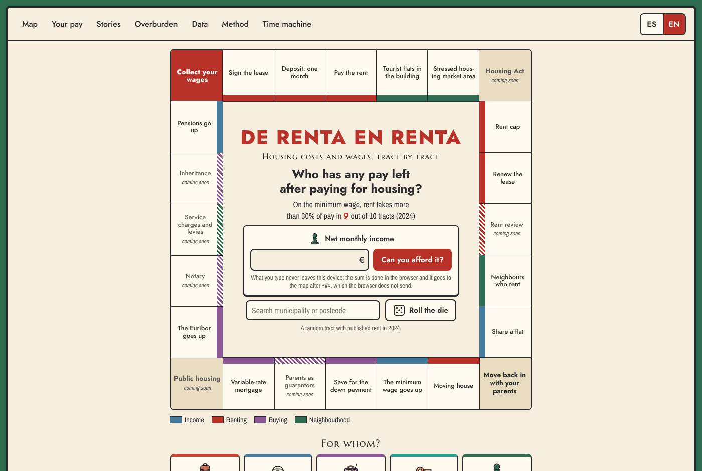

- **The centre.** The question, a minimum-wage figure that updates itself and the «Net monthly income» field. As you type, the home page says in what share of tracts the median rent stays within 30% of what you typed; «Can you afford it?» opens the map with that figure.
- **«Search municipality or postcode»** opens the map with the municipality's profile. **«Roll the die»** takes you to a random tract with published rent.
- **The squares.** Each one opens its map, profile or page. The colour band gives its family (income, renting, buying or neighbourhood); striped squares, «coming soon», do not lead anywhere yet.
- **Below:** «For whom?», with the five tokens (hover to see which income each one uses); the stories; and the «Atlas cards», three figures from the latest year with a link to their map.

<details>
<summary>Guide to the squares</summary>

| Square | Where it leads |
|---|---|
| Collect your wages | «Your pay» |
| Sign the lease | Map of net monthly pay needed |
| Deposit: one month | Methodological note, rent |
| Pay the rent | Map of monthly rent |
| Tourist flats in the building | Map of tourist dwellings |
| Stressed housing market area | Map of declared stressed areas |
| Rent cap | Map of the annual change in rents |
| Renew the lease | «Can you afford it?» with the neighbourhood household |
| Neighbours who rent | Map of renting households |
| Share a flat | «Your pay» with 70 m² |
| Move back in with your parents | Overburden: those who cannot get in |
| Moving house | Map with the comparison ready for a tract and its municipality |
| The minimum wage goes up | «Can you afford it?» with the minimum wage |
| Save for the down payment | Map of years of wages to buy a home |
| Variable-rate mortgage | Map of mortgage payment over income |
| The Euribor goes up | Time machine: interest rates |
| Pensions go up | «Can you afford it?» with the pension |
| Housing Act | «Rules of the game» (provisional summaries) |
| Rent review | «Rules of the game»: rent review |
| Parents as guarantors | «Rules of the game»: deposit and guarantees |
| Service charges and levies | «Rules of the game»: contract costs |
| Public housing · Notary · Inheritance | Coming soon |

</details>
</details>

<details>
<summary><b>The map</b></summary>

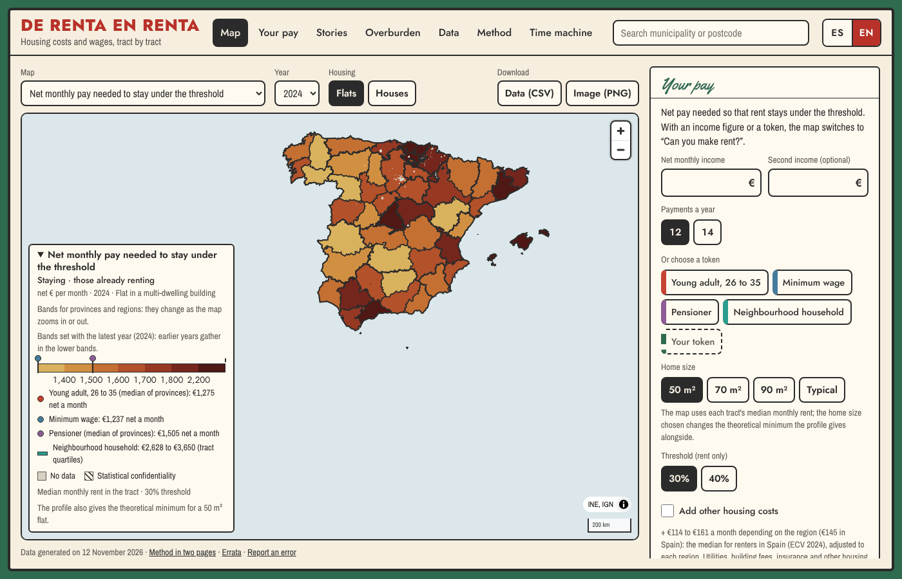

- **View bar**, above the map:
  - **«Map»**: the indicator that gives the colour. It opens on the net monthly pay needed so that the median rent stays within 30% of pay.
  - **«Year»**: if none is chosen, the latest of each series. If you choose a year before a series starts, that series shows no data and a notice says when it begins.
  - **«Housing»**: «Flats» or «Houses», only for series that tell them apart. They never mix.
  - **«Download»**: «Data (CSV)» and «Image (PNG)» (details in «Search, share and download», below).
- **Scales.** Zoomed out you see autonomous communities, provinces and municipalities; zoomed in, tracts. Each level shows the figure published for it: tracts are never added up to make a municipality. If an indicator does not reach the scale on screen, a notice asks you to zoom in or out.
- **Legend**, collapsible. It holds the colour bands, the source and, on maps in euros, a ruler with the tokens: where each reference income falls. For tracts, «Bands: Spain · *municipality*» switches to the municipality's own bands (septiles of its tracts), useful in cities where everything falls in the top band; they are not comparable with other municipalities.
- **Gaps.** Grey: no data. Striped: statistical confidentiality (there are leases, but fewer than 10, and the source does not publish the median).
- **With the mouse**, a label gives the name of what is underneath; **clicking** opens its profile. With the keyboard: the map takes focus, the arrows move it and Enter picks the area in the centre, marked with a cross.

</details>

<details>
<summary><b>«Your pay» and «Can you afford it?»</b></summary>

<p align="center">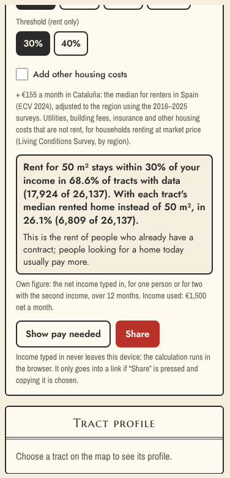</p>

The card to the right of the map (below it on a phone).

- **«Net monthly income»** and, if there are two salaries or a pension and a salary, **«Second income (optional)»**. **«Payments a year»**: 12 or 14; with 14, the two extra payments are spread over 12.
- **«Or choose a token»**: swaps your income for a token's.
- **«Home size»**: 50, 70 or 90 m², or **«Typical»**, the typical size of rented flats in the municipality (its median rent divided by its median rent per m²).
- **«Threshold»**: 30 or 40%. It is a convention, not a law, and it only counts rent.
- **«Add other housing costs»**: adds to rent what households renting at market price in your region pay on top each month (utilities, service charges, insurance…), from the Living Conditions Survey. With the minimum wage and 50 m², the tracts where rent stays within 30% fall from 51.6% to 13.4% (2024).
- **The result** says what and how much: in what share of tracts rent for 50 m² stays within the threshold and, next to it, the same sum with the median flat rented in each tract. Always with the reminder that this is the rent of those who already have a lease: those looking for a flat today usually pay more.
- **«Show pay needed»** returns to the opening map, which does the sum the other way round: how much you need to earn in each tract.
- **Your income never leaves your device.** The calculation runs in the browser; it is not in the address and it is not stored.

</details>

<details>
<summary><b>The profile of a tract or an area</b></summary>

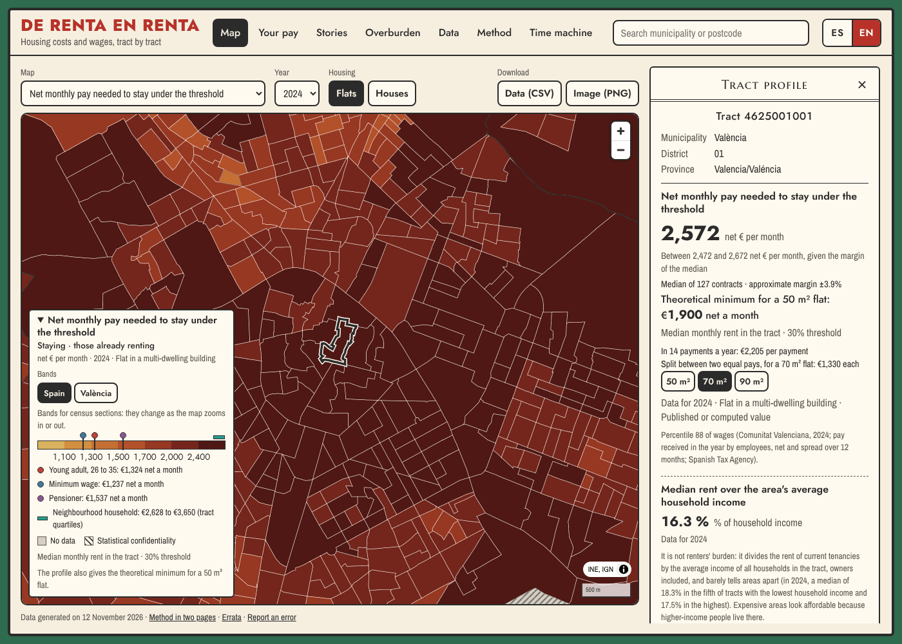

It opens when you click the map, search, or follow a link.

- **The map's figure**, with its **reliability**: «Median of N contracts · approximate margin ±X%» and the range that margin gives. Below 30 leases, the «few contracts» mark. In «Can you afford it?», if the margin puts the share on both sides of the threshold, the profile says it is «on the edge between two bands».
- **For pay needed, always two figures:** with the tract's actual median rent and, next to it, the theoretical minimum with a 50 m² flat. Also what it would be in 14 payments, each person's share between two equal salaries, and which percentile of wages in the region it falls on.
- **Median rent over the area's average household income**, with its reading note: it is not the burden of those who rent.
- **«Over time»**: chart and table since 2015, with each year's change, the margin band and a hollow dot where there are fewer than 30 leases. For series in euros, «2025 euros · Euros of each year» adjusts for inflation or not (CPI).
- **With no median** (fewer than 10 leases), a labelled context: the median of the other housing type in the tract and of the same type in its municipality. It is not drawn on the map.
- **Area profile**: a municipality, province or autonomous community, with its published figure, its changes over time and its comparison. For municipalities with a declared stressed area, the resolution, the area covered and its validity.

</details>

<details>
<summary><b>The comparison</b></summary>

<p align="center">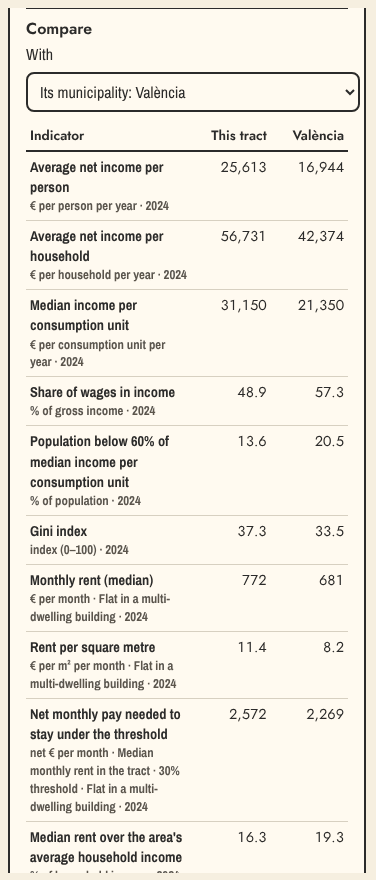</p>

At the end of the profile. **«Compare» → «With»**: its district, its municipality, its province, its autonomous community, Spain or **«Another tract (picked on the map)»**. Both columns use the same year and the same housing type. With «Add other housing costs» on, each column adds those of its region.

</details>

<details>
<summary><b>The stories</b></summary>

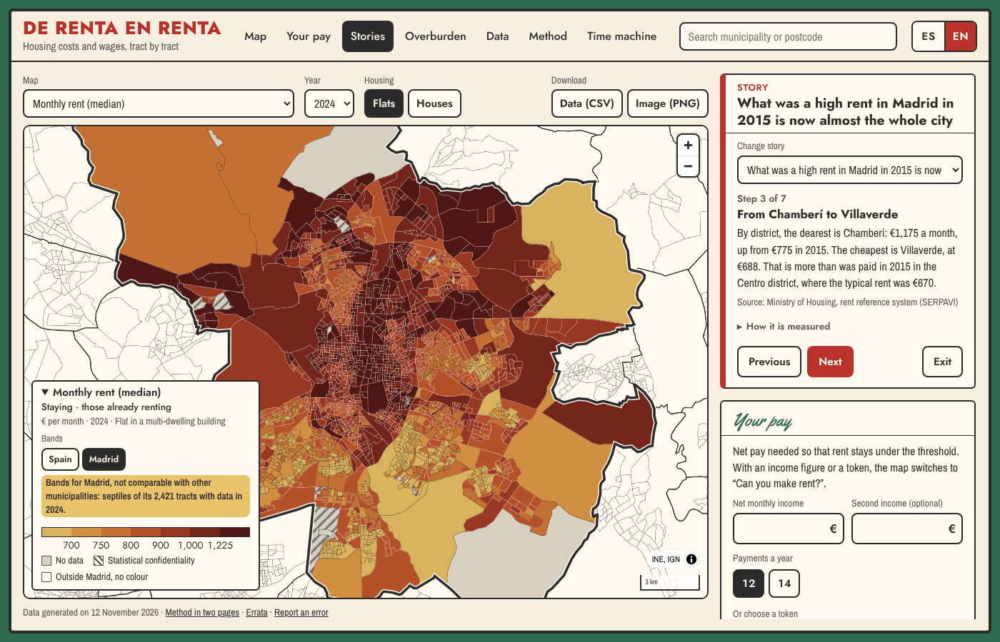

Guided tours inside the map: each step moves the map, the year, the scale or the profile and tells one thing, with a named place. **«Previous»**, **«Next»** and **«Exit»** (which leaves you on the map as it is); **«How it is measured»** expands the caveats of each step. Every figure in the texts is calculated by the pipeline: if an update moves one, the story is not published until it has been reviewed.

| Story | Steps |
|---|---|
| [What was a high rent in Madrid in 2015 is now almost the whole city](https://gastiaso.github.io/de-renta-en-renta/mapa.html?historia=centro&idioma=en) | 7 |
| [Three years of income in 1987, more than eight today](https://gastiaso.github.io/de-renta-en-renta/mapa.html?historia=anios&idioma=en) | 7 |
| [The minimum wage opened up half the rental map, then stalled in 2020](https://gastiaso.github.io/de-renta-en-renta/mapa.html?historia=minimo&idioma=en) | 8 |
| [For the deposit, your parents needed seven months of income; you need twenty](https://gastiaso.github.io/de-renta-en-renta/mapa.html?historia=padres&idioma=en) | 7 |

</details>

<details>
<summary><b>The time machine</b></summary>

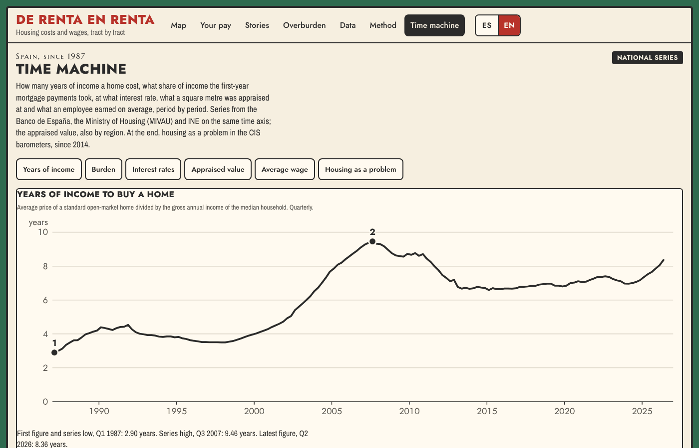

National series for Spain since 1987, with no map and a shared year axis: **years of income** to buy a home and theoretical first-year **burden** (Bank of Spain), reference **interest rates**, **appraised value** per square metre (Ministry of Housing; also by region), **average wage** per employee (INE) and, at the end, **housing as a problem** in the CIS barometers, month by month since 2014. Each chart can be read with the mouse or the keyboard, marks its key dates and has its table under «Show all figures». Appraised value and wages, in 2025 euros or euros of each year.

</details>

<details>
<summary><b>Overburden: the European board</b></summary>

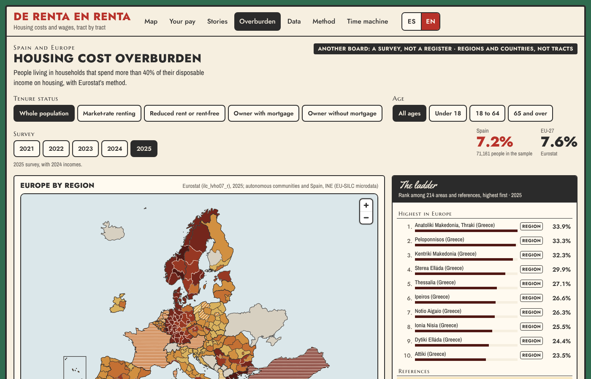

Another board: a survey, not a register; regions and countries, not tracts. It measures people living in households that spend more than 40% of their disposable income on housing, with the Eurostat method.

- **«Tenure status»**, **«Age»** and **«Survey»** (2021 to 2025). For the whole population, the map shows European regions; with a breakdown, which Eurostat does not publish by region, it shows countries, and Spain always by autonomous community (INE microdata).
- **«The ladder»** ranks in one list what the map shows: the highest in Europe, the references (EU-27 and Spain) and the autonomous communities at their rank. The rank is indicative: figures come without a margin of error.
- Below: the series for Spain and the EU-27, Spain's breakdowns by tenure, age and income quintile, and **«Those who cannot get in»**: unsuccessful housing searches from the 2025 module of the Living Conditions Survey.
- Overburden looks at those who already have a home: for the whole population the figure is low (7.2% in Spain in 2025), but among those renting at market price it rises to 26.8%. That is why the headline is market-rate tenants, with those who cannot get in alongside.

</details>

<details>
<summary><b>Search, share and download</b></summary>

- **Search**: by municipality name (accents optional; «Las Palmas» or «Palmas de Gran Canaria, Las»), by postcode (five digits: «28013 · Madrid») or by tract code (ten digits).
- **The address keeps your move.** Map, year, housing type, token, home size, threshold, tract, comparison, framing and language go in the URL: copying it is enough to come back to the same place. Example: [`mapa.html?mapa=alquiler_mes&seccion=4625001001&comparar=municipio&idioma=en`](https://gastiaso.github.io/de-renta-en-renta/mapa.html?mapa=alquiler_mes&seccion=4625001001&comparar=municipio&idioma=en).
- **«Share»** prepares the link. Your income only goes with it if you choose «Copy with my pay», after a warning, and travels after «#», the part of the address the browser does not send to the server.
- **«Data (CSV)»**: the map's series at the level on screen, one row per area, with code, name, value, unit, status, source and, for rent, the leases and the margin. In «Can you afford it?» it carries the rent rather than the share, from which the pay could be worked out.
- **«Image (PNG)»**: the map as shown, with title, legend, source and data date. With your token it warns first: the colours let the pay be guessed.
- Below the map: the date of the data, «Method in two pages», «Errata» and «Report an error».

</details>

<details>
<summary><b>On a phone</b></summary>

<p align="center">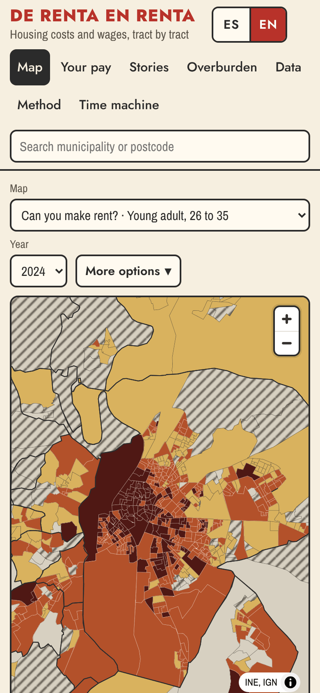</p>

Everything fits in one column. The bar folds into «More options»; the map moves with two fingers, so that one finger scrolls the page; the profile and «Your pay» go below the map. With a story open, the map stays at the top and the step right below it, with the buttons in view.

</details>

## 6. House rules

1. **Staying and moving in do not mix.** No figure combines current leases and asking prices; when they appear together, each carries its name.
2. **Net income, over 12 payments.** If rent were divided by one of a salary's 14 payments, its weight would come out inflated by around 17%.
3. **The threshold is a convention.** 30% (or 40%) only counts rent, unless you add the other costs. The same share leaves much less room on a low salary than on a high one.
4. **Pay needed always comes with two figures.** In 2024, in the median tract, €1,900 net a month with actual rent and €1,217 as a minimum with a 50 m² flat. Rented flats measure about 79 m² (the median, across tracts, of the ratio of each tract's monthly rent to its rent per m²).
5. **Each indicator at its own scale.** A provincial figure is never split among tracts, and medians are never added up.
6. **Same year top and bottom.** Rent and income are from the same year; when that is not possible (the current year's minimum wage), a notice says so.
7. **Each figure says how much it weighs.** Leases behind each median and an approximate margin; below 30 leases the figure is indicative and its annual change is not interpreted.
8. **Four statuses**: data, estimated (rebuilt with a written rule), statistical confidentiality and no data.
9. **Fixed geography.** Every series is brought to the 2021 tracts, so that years can be compared without boundaries moving.
10. **Euros of each year**, except where you choose otherwise (the profile's changes over time and the time machine).
11. **What does not add up does not go out.** More than 250 checks test the pipeline against the figures published by the sources and against itself; if a blocking check fails, nothing is published.

## 7. What the board does not see

- **SERPAVI** comes from the income tax returns of landlords who are individuals: it misses dwellings owned by companies, rentals between relatives and undeclared rentals. It measures the rented stock, not what newcomers pay. In 2024, 72% of tracts have data, home to around 84% of the population. Navarre has data from 2021; Gipuzkoa, from 2022; Álava and Bizkaia, only for 2024.
- **Household income** is that of all households in the tract, owners included, not that of renters.
- **Tax Agency wages** are what was received in the year, including by those who worked only a few months, and do not cover the Basque Country or Navarre.
- **«Money left over»** is a subtraction: income minus rent. It does not say whether it is enough to live on.
- **It runs one or two years behind.** Income and rent reach 2024; wages and pensions, 2025.
- **Overburden** comes from a survey: a sample, not a register, and it counts people, not households.

All the caveats, in the [«Method in two pages»](https://gastiaso.github.io/de-renta-en-renta/short_method.html) and the [methodological note](https://gastiaso.github.io/de-renta-en-renta/method.html).

## 8. Squares under construction

- **«Moving in»**: Idealista's asking prices by municipality and what moving in costs compared with staying. The pipeline has it ready as a removable layer, switched off; it will go live when Idealista authorises it in writing, and it will never be in the downloads.
- **«Rules of the game»**: summaries of the national rules on renting and buying, with their articles of the consolidated BOE. The «Housing Act», «Rent review», «Parents as guarantors» and «Service charges and levies» squares already lead to the page, but the summaries are provisional: until their legal review, only their titles are published.
- **«Public housing»** (subsidised housing), **«Notary»** and **«Inheritance»**: striped squares on the board.

## 9. Playing with the data

Every figure that passes the gate is in a long table, with one row per area, year, indicator and breakdown:

```
geo_id | nivel | anio | indicador | corte | grupo | valor | estado | fuente | geo_ref | version
```

| File | Contents |
|---|---|
| [`tabla_larga.parquet`](https://gastiaso.github.io/de-renta-en-renta/descargas/tabla_larga.parquet) | The indicators, from tract to Spain |
| [`historico.parquet`](https://gastiaso.github.io/de-renta-en-renta/descargas/historico.parquet) | The time machine series |
| [`version.json`](https://gastiaso.github.io/de-renta-en-renta/descargas/version.json) | Date, commit, coverage by indicator, licences and SHA-256 sums |
| [Release `v1.2.0`](https://github.com/gastiaso/de-renta-en-renta/releases/tag/v1.2.0) | All of the above, the website data and the base map, with `SHA256SUMS` |

```r
library(arrow); library(dplyr)
rent <- open_dataset("tabla_larga.parquet") |>
  filter(indicador == "alquiler_m2", nivel == "municipio", anio == 2024,
         corte == "tipologia", grupo == "VC") |>
  collect()
```

```python
import pandas as pd
rent = pd.read_parquet("tabla_larga.parquet", filters=[
    ("indicador", "==", "alquiler_m2"), ("nivel", "==", "municipio"), ("anio", "==", 2024),
    ("corte", "==", "tipologia"), ("grupo", "==", "VC")])
```

Data model, column values and indicator dictionary: the [«Data»](https://gastiaso.github.io/de-renta-en-renta/data.html) page. Portal asking prices are not in any download.

## 10. Under the board

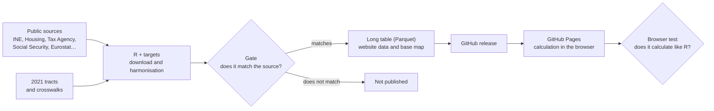

- **Pipeline in R** with [`targets`](https://docs.ropensci.org/targets/): one function per source and step, decisions in CSV files (`inventario/`), not in the code.
- **Constant geography**: each year is brought to the 2021 tracts with crosswalks (INE street index where tracts fall whole; Cadastre buildings where they need to be split).
- **Gate** (`inventario/referencias_validacion.csv`): blocking checks stop the pipeline; warning checks flag.
- **Serverless website**: uncompiled HTML and JavaScript, [MapLibre](https://maplibre.org/) with [PMTiles](https://docs.protomaps.com/pmtiles/) for the tracts and hand-made SVG charts; no cookies or analytics (GitHub Pages, which hosts it, may log which files are downloaded). A test recalculates a sample of figures in a headless browser and compares them with R.
- **Identity**: its own board, inspired by *The Landlord's Game* (Lizzie Magie, 1904), in the public domain; colours with calculated contrast and a ramp tested against simulated colour blindness ([`diseno/`](diseno/)).

### Build your own board

You need R 4.6.1 (with `renv`), GDAL 3.8 or later with the PMTiles driver, Node 18 or later, about 12 GB of disk and 16 GB of memory. From the project folder:

```r
renv::restore()                          # first time only: the versions in renv.lock
source("R/brutos_comprobar.R"); brutos_informe()   # what is missing in datos/brutos/ (downloads nothing)
targets::tar_make()                      # downloads, calculates and runs the gate
testthat::test_dir("pruebas/testthat")
```

From scratch it downloads about 9.6 GB. Three sources cannot be downloaded automatically (SERPAVI, the Land Registrars and the IGN units): `tar_make()` stops and says what to download and under what name. A full run for all of Spain takes about three and a quarter hours of computation, plus the downloads (measured on 18 Nov 2026 in a clean copy with a complete `datos/brutos/`: 3 h 56 min, 2 h 12 min of it for the Cadastre); with `PROVINCIA=28` in the environment it is limited to one province. The step-by-step guide, in Spanish: [`docs/reproducir.md`](docs/reproducir.md). To see the website:

```sh
node web/servir.mjs                      # http://localhost:8000
```

Without pipeline data, the website loads a sample with **made-up** values for Madrid's Centro district, labelled «Sample data». To see it with the published data without running the pipeline, unpack `datos_web.tar.gz` from the latest release into `web/` and copy `seccionado_2021.pmtiles` into `web/teselas/`.

More documentation: [methodological note](docs/methodology.md) · [method in two pages](docs/short_method.md) · [data](docs/data.md). In Spanish only: [reproducing from scratch](docs/reproducir.md) · [source updates](docs/actualizacion.md) · [publication](docs/publicacion.md) · [website](web/LEEME.md) · [design](diseno/LEEME.md) · [contributing](CONTRIBUTING.md).

## 11. Sources

| What | Source |
|---|---|
| Household income by tract | INE, Household Income Distribution Atlas (ADRH) |
| Rent by tract | Ministry of Housing and Urban Agenda, State Reference System for Housing Rental Prices (SERPAVI) |
| Wages and pensions | Tax Agency, *Mercado de trabajo y pensiones en las fuentes tributarias*; Social Security, contributory pensions |
| Minimum wage | Official State Gazette (BOE), each year's royal decree |
| Change in rents, renting households, tourist dwellings, mortgages and CPI | INE |
| Sales | Spanish Land Registrars (ODbL); appraised value, Ministry of Housing |
| Stressed areas | Declarations published in the BOE and by the autonomous communities |
| Geography | INE (tracts, street index and population register), IGN, Cadastre and foral cadastres |
| Overburden and access | INE, Living Conditions Survey (microdata and 2025 module); Eurostat; GISCO geometries |
| Time machine | Bank of Spain, Ministry of Housing, INE and CIS |

Full list, with each source's licence and frequency: [`inventario/fuentes.csv`](inventario/fuentes.csv).

## How to cite

> Astiaso Llamazares, G. (2026). *De renta en renta: atlas de vivienda y salarios por sección censal* [software and data]. https://gastiaso.github.io/de-renta-en-renta/. CC BY-SA 4.0. Data source: [original source].

Add the date of the data (shown below the map) and the date of access. Land Registrars' figures (sale price) carry ODbL 1.0 instead of CC BY-SA 4.0.

GitHub offers the citation in other formats (APA, BibTeX) from the *Cite this repository* button.

## Licences

- **Code:** [MIT](LICENSE).
- **Derived data, texts and inventory:** [CC BY-SA 4.0](https://creativecommons.org/licenses/by-sa/4.0/). They can be reused for any purpose, crediting the author and publishing anything derived under the same licence.
- **Sale price (Land Registrars):** [ODbL 1.0](https://opendatacommons.org/licenses/odbl/1-0/).
- **European geometries (GISCO):** non-commercial use, with the notice «© EuroGeographics for the administrative boundaries».
- **Source data:** each source's own terms; cite it as well.
- **Portal asking prices:** not redistributed.

Details in [`LICENCIA_DATOS.md`](LICENCIA_DATOS.md) (in Spanish). The project has no funding, advertising or sponsorship, and none of the sources endorses it.

## Contact

Errors, questions or better sources: open an [issue](https://github.com/gastiaso/de-renta-en-renta/issues) with the indicator, the area, the year and the source you compare with, or write on [LinkedIn](https://www.linkedin.com/in/guillermo-astiaso). Corrections go to the errata and the [changelog](CHANGELOG.md).

## Related projects

- [Barómetro a barómetro](https://github.com/gastiaso/barometros): series from the CIS monthly barometers since 2021, calculated from the microdata.
- [Historias con los barómetros del CIS](https://github.com/gastiaso/historias): among them, how housing became Spain's top problem.
- [ineAtlas](https://github.com/pablogguz/ineAtlas), by Pablo García Guzmán: the Household Income Distribution Atlas data from R.
- [mapSpain](https://github.com/rOpenSpain/mapSpain), by rOpenSpain: Spain's administrative boundaries for R.

*Versión en castellano: [README.md](README.md).*
