# De renta en renta

**Vivienda y sueldos, sección a sección: un atlas con forma de juego de mesa para responder a una pregunta. ¿A quién le queda sueldo después de pagar la vivienda?**

### → [gastiaso.github.io/de-renta-en-renta](https://gastiaso.github.io/de-renta-en-renta/)

[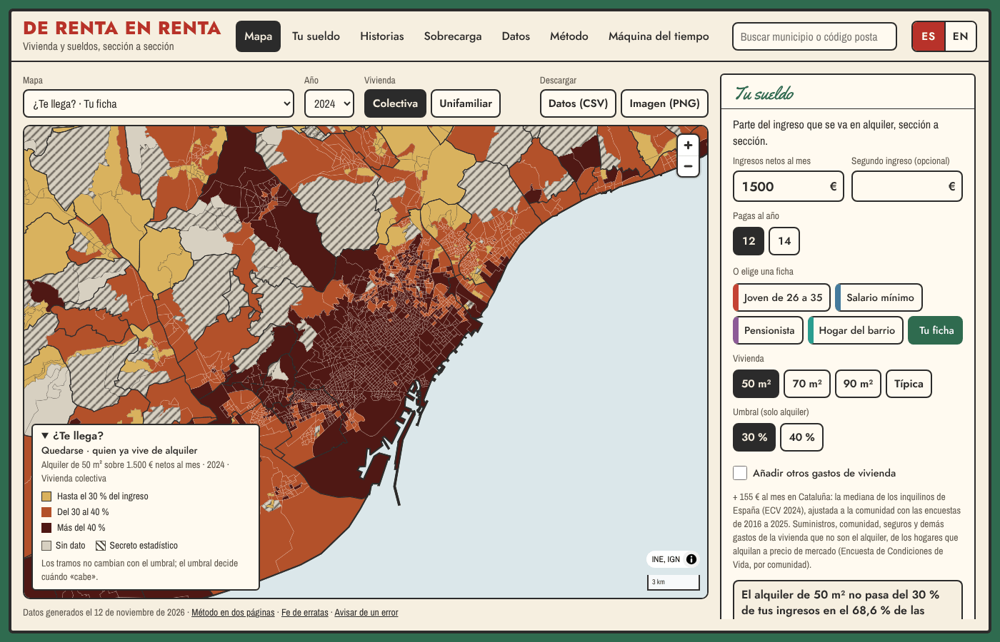](https://gastiaso.github.io/de-renta-en-renta/mapa.html#tu-sueldo)

*De renta en renta, y pago porque me toca.* El nombre juega con el «de oca a oca» y con los dos sentidos de *renta*: lo que se paga por la casa y lo que se cobra. El atlas pone las dos cosas frente a frente en las 36.333 secciones censales de España, de 2015 al último dato, con cinco fichas que cambian el ingreso de referencia (un hogar del barrio, una persona joven, el salario mínimo, una pensión y tus propios ingresos), una máquina del tiempo desde 1987 y un tablero europeo de sobrecarga por gastos de vivienda.

| | |
|---|---|
| **Jugadores** | De uno en adelante: periodistas de datos, personal técnico de administraciones y entidades, y quien esté buscando piso |
| **Edad recomendada** | A partir de la primera nómina |
| **Duración** | De un minuto («¿te llega?») a una tarde (la tabla larga en R, Python o DuckDB) |
| **Material** | Un navegador. No hay que instalar nada, y los ingresos que escribes no salen de tu dispositivo |
| **Edición** | v1.2.0, 18 de noviembre de 2026 ([registro de cambios](CHANGELOG.md)) |

> **Tablero en construcción.** Las cifras, los métodos y este reglamento son provisionales y se revisan con cada edición. Si algo no cuadra, [avisa](#contacto).

## Índice

1. [Objeto del juego](#1-objeto-del-juego)
2. [Contenido de la caja](#2-contenido-de-la-caja)
3. [Las fichas](#3-las-fichas)
4. [Partida rápida](#4-partida-rápida)
5. [Cómo se juega](#5-cómo-se-juega)
6. [Reglas de la casa](#6-reglas-de-la-casa)
7. [Lo que el tablero no ve](#7-lo-que-el-tablero-no-ve)
8. [Casillas en obras](#8-casillas-en-obras)
9. [Para jugar con los datos](#9-para-jugar-con-los-datos)
10. [Debajo del tablero](#10-debajo-del-tablero)
11. [Fuentes](#11-fuentes), [cómo citar](#cómo-citar), [licencias](#licencias) y [contacto](#contacto)

## 1. Objeto del juego

Averiguar **dónde, desde cuándo y para quién** ha cambiado la relación entre lo que cuesta la vivienda y lo que se cobra. Para quien ya está en el tablero y para quien entra nuevo en la partida.

Un ejemplo de lo que se encuentra: en 2024, con el salario mínimo (1.237 € netos al mes), el alquiler mediano de cada sección pasa del 30 % del sueldo en 9 de cada 10 secciones con dato. Con un piso de 50 m², en casi la mitad (48,4 %).

Se juega con dos familias de cifras que **nunca se mezclan**:

| | **Quedarse** | **Entrar** |
|---|---|---|
| A quién mide | A quien ya vive de alquiler | A quien busca piso hoy |
| Fuente | SERPAVI (Ministerio de Vivienda): contratos vigentes declarados a Hacienda | Precios de oferta de los portales; índice del INE de contratos nuevos |
| Qué es la cifra | Mediana del alquiler de los contratos vigentes | Lo que se pide en los anuncios |
| Escala | Sección censal | Municipio con oferta publicada y escalas superiores |
| En el tablero | Mapas, fichas y descargas | Próximamente ([casillas en obras](#8-casillas-en-obras)) |

## 2. Contenido de la caja

- **1 tablero de portada** con 24 casillas: 21 llevan a un mapa, a una ficha o a una página (cuatro, a «Reglas del juego», con resúmenes provisionales); las 3 rayadas están en obras.
- **36.333 casillas de mapa**: las secciones censales de 2021, con sus 8.131 municipios, 52 provincias y 19 comunidades y ciudades autónomas.
- **5 fichas** de perfil, cada una con su ingreso y su vivienda.
- **17 mapas** en el selector, más un «¿te llega?» por ficha.
- **24 indicadores**, cada uno en la escala en que lo publica su fuente.
- **4 historias** guiadas, paso a paso, dentro del mapa.
- **1 máquina del tiempo**: series de España desde 1987.
- **1 tablero europeo**: la sobrecarga por gastos de vivienda, con el método de Eurostat.
- **1 tabla larga** en Parquet con todas las cifras que pasan la compuerta.

<details>
<summary><b>Los 24 indicadores</b></summary>

| # | Indicador | Escala más fina | Años | Dónde se ve |
|---|---|---|---|---|
| 1 | Renta neta media por persona | Sección | 2015–2024 | Mapa |
| 2 | Renta neta media por hogar | Sección | 2015–2024 | Mapa |
| 3 | Mediana de la renta por unidad de consumo | Sección | 2015–2024 | Mapa |
| 4 | Peso de los salarios en la renta | Sección | 2015–2024 | Mapa |
| 5 | Población por debajo del 60 % de la mediana de renta por unidad de consumo | Sección | 2015–2024 | Mapa |
| 6 | Índice de Gini | Sección | 2015–2024 | Mapa |
| 7 | Salario medio anual por asalariado (total y de 26 a 35 años) | Provincia | 2011–2025 | Fichas y percentil salarial |
| 8 | Alquiler mensual (mediana) | Sección | 2015–2024 | Mapa |
| 9 | Alquiler por metro cuadrado | Sección | 2015–2024 | Mapa |
| 10 | Variación anual del alquiler | Distrito de las capitales | 2015–2024 | Mapa |
| 11 | Precio de compraventa por metro cuadrado | Provincia | 2015–2025 | Mapa |
| 12 | Valor tasado por metro cuadrado | Municipio de más de 25.000 habitantes | 2015–2025 | Mapa |
| 13 | Precio de oferta (alquiler y venta) | Municipio y zona del portal | — | Próximamente |
| 14 | Alquiler mediano sobre renta media del barrio | Sección | 2015–2024 | Ficha |
| 15 | Peso del alquiler en el ingreso | Sección | 2015–2024 | «¿Te llega?» |
| 16 | Años de salario para comprar | Municipio de más de 25.000 habitantes | 2015–2025 | Mapa |
| 17 | Cuota hipotecaria sobre la renta del hogar | Municipio de más de 25.000 habitantes | 2015–2024 | Mapa |
| 18 | Hogares en alquiler | Sección | 2011 y 2021 | Mapa |
| 19 | Viviendas de uso turístico sobre el total de viviendas | Sección | 2020–2026 | Mapa |
| 20 | Zona de mercado residencial tensionado declarada | Municipio | 2024–2026 | Mapa |
| 21 | Sueldo neto necesario para no pasar del umbral | Sección | 2015–2024 | Mapa (el de entrada) |
| 22 | Tasa de sobrecarga por gastos de vivienda (método Eurostat) | Región europea; comunidad en España | España desde 2004; comunidades, 2016–2025; regiones, 2021–2025 | Sobrecarga |
| 23 | Búsqueda de vivienda sin éxito | Comunidad | 2025 | Sobrecarga |
| 24 | Tasa de riesgo de pobreza tras los gastos de vivienda | Comunidad | 2016–2025; España desde 2004 y UE-27 desde 2010 | Sobrecarga |

Definición, cálculo y lectura de cada uno: [diccionario de la página «Datos»](https://gastiaso.github.io/de-renta-en-renta/datos.html) e [`inventario/indicadores.csv`](inventario/indicadores.csv).

</details>

## 3. Las fichas

Cada ficha es un ingreso de referencia. Todos van **en neto mensual, repartido en 12 pagas**, porque el alquiler se paga doce veces al año. Las fichas de una persona buscan **50 m²**, para que sus mapas solo cambien por el ingreso.

| Ficha | Ingreso | Escala | Vivienda |
|:---:|---|---|---|
| <br>**Joven de 26 a 35** | Mediana estimada de lo cobrado en el año por los asalariados de 26 a 35 años de su provincia, también quien no trabajó los doce meses (AEAT) | Provincia | 50 m² |
| <br>**Salario mínimo** | Salario mínimo interprofesional neto de cada año (BOE) | España | 50 m² |
| <br>**Pensionista** | Pensión media de jubilación neta (Seguridad Social); la media, porque no se publica la mediana por provincia | Provincia | 50 m² |
| <br>**Hogar del barrio** | Renta neta media de todos los hogares de la sección, propietarios incluidos (INE) | Sección | El alquiler mediano de su sección |
| <br>**Tu ficha** | Lo que escribas: tus ingresos, en 12 o 14 pagas, y un segundo ingreso si lo hay | — | 50 m² (70 con dos ingresos); también 90 m² o la superficie típica |

La llave mide otra cosa que las demás: el peso del alquiler en la renta de quien ya vive allí, no lo que cuesta entrar. Los barrios caros parecen asequibles con ella porque los habita gente con más renta.

## 4. Partida rápida

1. **Coloca tu ficha.** Abre el [tablero](https://gastiaso.github.io/de-renta-en-renta/) y escribe tus ingresos netos al mes en el centro. La portada hace la cuenta sin salir de la página.
2. **Pregunta «¿Te llega?».** El mapa pinta cada sección en tres tramos: el alquiler se lleva hasta el 30 % de tus ingresos, del 30 al 40 % o más del 40 %.
3. **Cambia de ficha.** En «¿Para quién?», o en la tarjeta «Tu sueldo» del mapa, mira el mismo mapa con el ingreso de otra persona.
4. **Cae en una casilla.** Acércate y pulsa una sección: su ficha da la cifra, cuántos contratos hay detrás, cómo ha cambiado desde 2015 y con qué se compara.
5. **Guarda la jugada.** Comparte la vista con un enlace o descarga el mapa en CSV o PNG.

¿Sin plan? **«Tira el dado»** en la portada y empieza por una sección al azar.

## 5. Cómo se juega

Cada bloque se despliega. Los nombres entre comillas son los de los botones de la web.

<details>
<summary><b>El tablero (la portada)</b></summary>

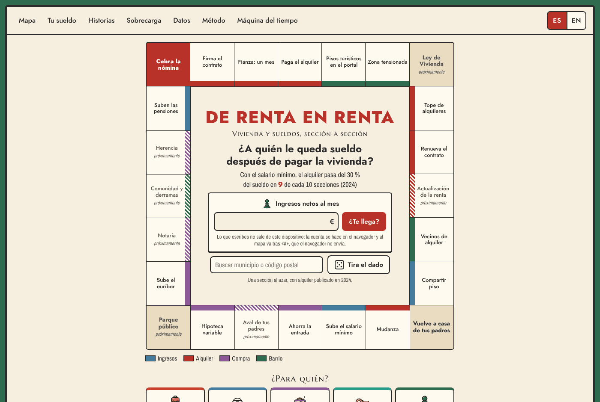

- **El centro.** La pregunta, una cifra del salario mínimo que se actualiza sola y el campo «Ingresos netos al mes». Al escribir, la portada dice en qué parte de las secciones el alquiler mediano no pasa del 30 % de lo escrito; «¿Te llega?» abre el mapa con esa cifra.
- **«Buscar municipio o código postal»** abre el mapa con la ficha del municipio. **«Tira el dado»** lleva a una sección al azar con alquiler publicado.
- **Las casillas.** Cada una abre el mapa, la ficha o la página que le corresponde. La banda de color dice su familia (ingresos, alquiler, compra o barrio); las rayadas, «próximamente», todavía no llevan a ninguna parte.
- **Debajo:** «¿Para quién?», con las cinco fichas (al pasar el ratón, qué ingreso usa cada una); las historias; y las «Cartas del atlas», tres cifras del último año con enlace a su mapa.

<details>
<summary>Guía de casillas</summary>

| Casilla | Adónde lleva |
|---|---|
| Cobra la nómina | «Tu sueldo» |
| Firma el contrato | Mapa del sueldo neto necesario |
| Fianza: un mes | Nota metodológica, alquiler |
| Paga el alquiler | Mapa del alquiler mensual |
| Pisos turísticos en el portal | Mapa de viviendas de uso turístico |
| Zona tensionada | Mapa de zonas tensionadas declaradas |
| Tope de alquileres | Mapa de la variación anual del alquiler |
| Renueva el contrato | «¿Te llega?» con el hogar del barrio |
| Vecinos de alquiler | Mapa de hogares en alquiler |
| Compartir piso | «Tu sueldo» con 70 m² |
| Vuelve a casa de tus padres | Sobrecarga: quien no consigue entrar |
| Mudanza | Mapa con el comparador listo para la sección y su municipio |
| Sube el salario mínimo | «¿Te llega?» con el salario mínimo |
| Ahorra la entrada | Mapa de años de salario para comprar |
| Hipoteca variable | Mapa de la cuota hipotecaria |
| Sube el euríbor | Máquina del tiempo: tipos de interés |
| Suben las pensiones | «¿Te llega?» con la pensión |
| Ley de Vivienda | «Reglas del juego» (resúmenes provisionales) |
| Actualización de la renta | «Reglas del juego»: actualización de la renta |
| Aval de tus padres | «Reglas del juego»: fianza y garantías |
| Comunidad y derramas | «Reglas del juego»: gastos del contrato |
| Parque público · Notaría · Herencia | Próximamente |

</details>
</details>

<details>
<summary><b>El mapa</b></summary>

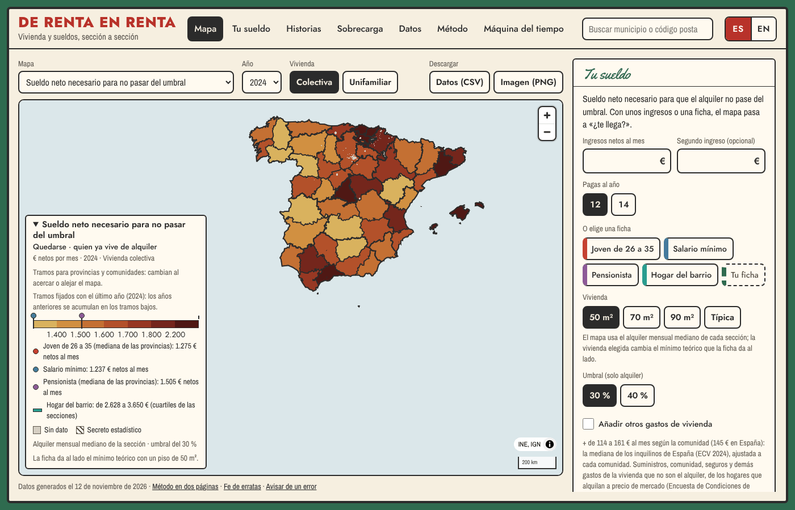

- **Barra de la vista**, encima del mapa:
  - **«Mapa»**: el indicador que da color. Abre en el sueldo neto necesario para que el alquiler mediano no pase del 30 % del sueldo.
  - **«Año»**: sin elegir, el último de cada serie. Si eliges un año anterior al inicio de una serie, esa serie sale sin dato y un aviso dice desde cuándo empieza.
  - **«Vivienda»**: «Colectiva» (pisos) o «Unifamiliar», solo en las series que distinguen. Nunca se mezclan.
  - **«Descargar»**: «Datos (CSV)» e «Imagen (PNG)» (detalle en «Buscar, compartir y descargar», más abajo).
- **Escalas.** Al alejar se ven comunidades, provincias y municipios; al acercar, secciones. Cada nivel enseña la cifra publicada para él: nunca se suman secciones para inventar un municipio. Si un indicador no llega a la escala que ves, un aviso pide acercar o alejar.
- **Leyenda**, plegable. Lleva los tramos de color, la fuente y, en los mapas de euros, una regla con las fichas: dónde cae cada ingreso de referencia. En las secciones, «Tramos: De España · De *municipio*» cambia a tramos propios del municipio (septiles de sus secciones), útiles en ciudades donde todo cae en el tramo más alto; no se comparan con otros municipios.
- **Huecos.** Gris: sin dato. Rayado: secreto estadístico (hay alquileres, pero menos de 10 contratos y la fuente no publica la mediana).
- **Con el ratón**, una etiqueta da el nombre de lo que hay debajo; **al pulsar**, se abre su ficha. Con el teclado: el mapa toma el foco, las flechas lo mueven e Intro elige el territorio del centro, marcado con una cruz.

</details>

<details>
<summary><b>«Tu sueldo» y «¿te llega?»</b></summary>

<p align="center">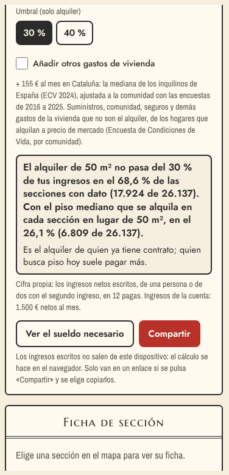</p>

La tarjeta de la derecha del mapa (en el móvil, debajo).

- **«Ingresos netos al mes»** y, si hay dos sueldos o una pensión y un sueldo, **«Segundo ingreso (opcional)»**. **«Pagas al año»**: 12 o 14; con 14, las dos extras se reparten en 12.
- **«O elige una ficha»**: cambia tus ingresos por los de una ficha.
- **«Vivienda»**: 50, 70 o 90 m², o **«Típica»**, la superficie típica de los pisos alquilados del municipio (su alquiler mediano entre su alquiler mediano por m²).
- **«Umbral»**: 30 o 40 %. Es una convención, no una ley, y solo cuenta el alquiler.
- **«Añadir otros gastos de vivienda»**: suma al alquiler lo que pagan de más al mes los hogares que alquilan a precio de mercado en tu comunidad (suministros, comunidad, seguros…), según la Encuesta de Condiciones de Vida. Con el salario mínimo y 50 m², las secciones donde no se pasa del 30 % bajan del 51,6 al 13,4 % (2024).
- **El resultado** dice qué y cuánto: en qué parte de las secciones el alquiler de 50 m² no pasa del umbral y, al lado, la misma cuenta con el piso mediano que se alquila en cada sección. Siempre con el aviso de que es el alquiler de quien ya tiene contrato: quien busca piso hoy suele pagar más.
- **«Ver el sueldo necesario»** vuelve al mapa de entrada, que hace la cuenta al revés: cuánto hay que cobrar en cada sección.
- **Tus ingresos no salen del dispositivo.** El cálculo se hace en el navegador, no van en la dirección y no se guardan.

</details>

<details>
<summary><b>La ficha de una sección o de un territorio</b></summary>

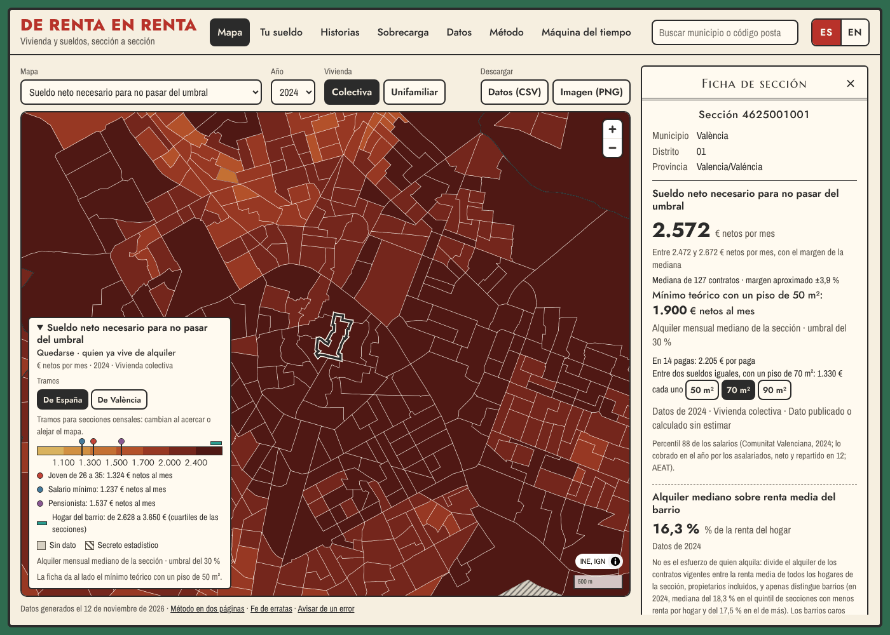

Se abre al pulsar el mapa, al buscar o desde un enlace.

- **La cifra del mapa**, con su **fiabilidad**: «Mediana de N contratos · margen aproximado ±X %» y el intervalo que deja ese margen. Por debajo de 30 contratos, la marca «pocos contratos». En «¿te llega?», si el margen deja la proporción a los dos lados del umbral, la ficha dice que está «en el límite entre dos tramos».
- **En el sueldo necesario, dos cifras siempre:** con el alquiler mediano real de la sección y, al lado, el mínimo teórico con un piso de 50 m². Además, lo que sería en 14 pagas, lo de cada uno entre dos sueldos iguales y en qué percentil de los salarios de la comunidad cae.
- **Alquiler mediano sobre renta media del barrio**, con su aviso de lectura: no es el esfuerzo de quien alquila.
- **«Evolución»**: gráfico y tabla desde 2015, con la variación de cada año, la banda del margen y un punto hueco donde hay menos de 30 contratos. En las series en euros, «Euros de 2025 · Euros de cada año» descuenta o no la inflación (IPC).
- **Sin mediana** (menos de 10 contratos), un contexto rotulado: la mediana de la otra tipología en la sección y la de la misma en su municipio. No se pinta en el mapa.
- **Ficha de territorio**: un municipio, una provincia o una comunidad, con su cifra publicada, su evolución y su comparador. En los municipios con zona tensionada declarada, la resolución, el ámbito y la vigencia.

</details>

<details>
<summary><b>El comparador</b></summary>

<p align="center">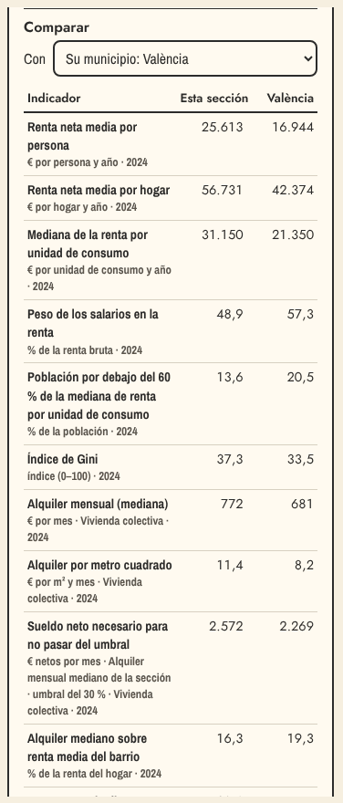</p>

Al final de la ficha. **«Comparar» → «Con»**: su distrito, su municipio, su provincia, su comunidad, España u **«Otra sección (se elige en el mapa)»**. Las dos columnas usan el mismo año y la misma vivienda. Con «Añadir otros gastos de vivienda» encendido, cada columna suma los de su comunidad.

</details>

<details>
<summary><b>Las historias</b></summary>

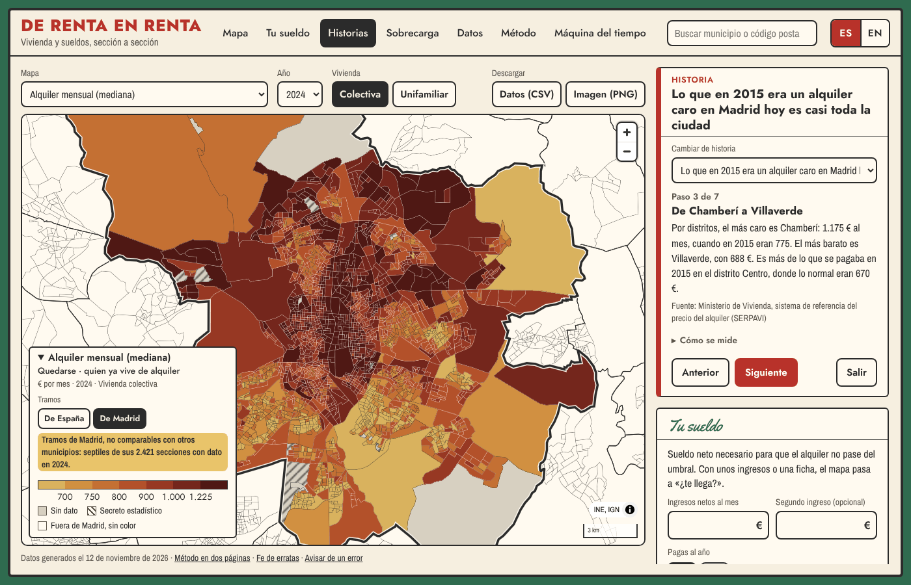

Recorridos guiados dentro del mapa: cada paso mueve el mapa, el año, la escala o la ficha y cuenta una cosa, con un lugar con nombre. **«Anterior»**, **«Siguiente»** y **«Salir»** (que te deja en el mapa tal como está); **«Cómo se mide»** despliega los matices de cada paso. Todas las cifras de los textos las calcula el pipeline: si una actualización las mueve, la historia no se publica hasta revisarla.

| Historia | Pasos |
|---|---|
| [Lo que en 2015 era un alquiler caro en Madrid hoy es casi toda la ciudad](https://gastiaso.github.io/de-renta-en-renta/mapa.html?historia=centro) | 7 |
| [Tres años de renta en 1987, más de ocho hoy](https://gastiaso.github.io/de-renta-en-renta/mapa.html?historia=anios) | 7 |
| [El salario mínimo abrió medio mapa del alquiler y se paró en 2020](https://gastiaso.github.io/de-renta-en-renta/mapa.html?historia=minimo) | 8 |
| [Para la entrada, tus padres necesitaron siete meses de ingresos; tú, veinte](https://gastiaso.github.io/de-renta-en-renta/mapa.html?historia=padres) | 7 |

</details>

<details>
<summary><b>La máquina del tiempo</b></summary>

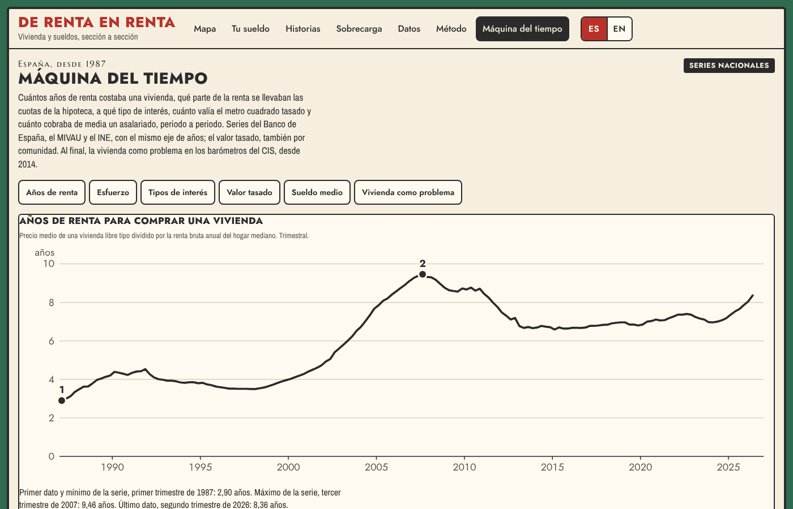

Series de España desde 1987, sin mapa, con el mismo eje de años: **años de renta** para comprar una vivienda y **esfuerzo** teórico del primer año (Banco de España), **tipos de interés** de referencia, **valor tasado** del metro cuadrado (MIVAU; también por comunidad), **sueldo medio** por asalariado (INE) y, al final, la **vivienda como problema** en los barómetros del CIS, mes a mes desde 2014. Cada gráfico se lee con el ratón o con el teclado, marca sus fechas clave y trae la tabla en «Ver todas las cifras». El valor tasado y el sueldo, en euros de 2025 o de cada año.

</details>

<details>
<summary><b>Sobrecarga: el tablero europeo</b></summary>

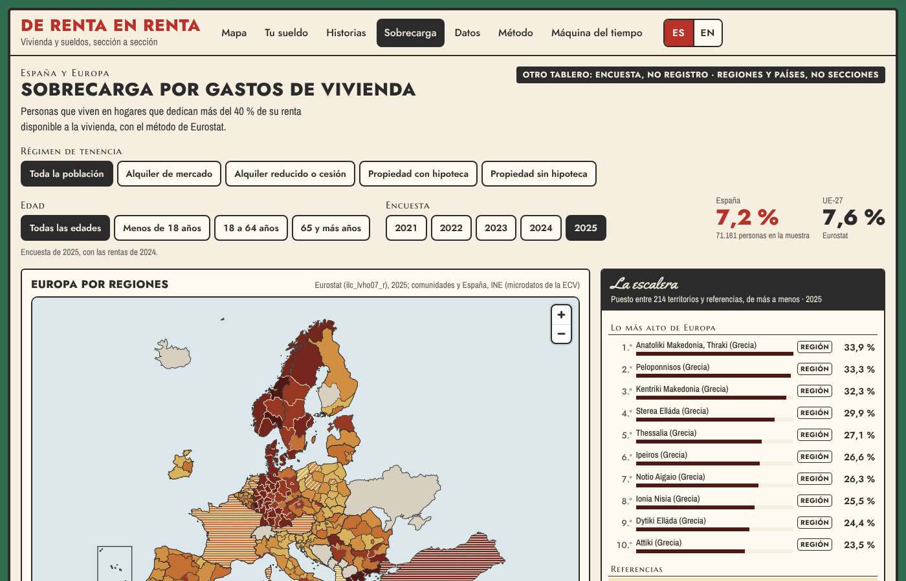

Otro tablero: encuesta, no registro; regiones y países, no secciones. Mide a las personas que viven en hogares que dedican más del 40 % de su renta disponible a la vivienda, con el método de Eurostat.

- **«Régimen de tenencia»**, **«Edad»** y **«Encuesta»** (2021 a 2025). Con toda la población, el mapa va por regiones europeas; con un desglose, que Eurostat no publica por regiones, por países, y España siempre por comunidades (microdatos del INE).
- **«La escalera»** ordena en una lista lo que enseña el mapa: lo más alto de Europa, las referencias (UE-27 y España) y las comunidades en su puesto. El puesto es orientativo: las cifras van sin margen de error.
- Debajo: la serie de España y de la UE-27, los desgloses de España por tenencia, edad y quintil de renta, y **«Quien no consigue entrar»**: la búsqueda de vivienda sin éxito del módulo de 2025 de la Encuesta de Condiciones de Vida.
- La sobrecarga mira a quien ya tiene casa: con toda la población la cifra es baja (7,2 % en España en 2025), pero entre quienes alquilan a precio de mercado sube al 26,8 %. Por eso el titular son los inquilinos de mercado, y al lado va quien no consigue entrar.

</details>

<details>
<summary><b>Buscar, compartir y descargar</b></summary>

- **Buscar**: por nombre de municipio (sin tildes; «Las Palmas» o «Palmas de Gran Canaria, Las»), por código postal (cinco cifras: «28013 · Madrid») o por código de sección (diez cifras).
- **La dirección guarda la jugada.** Mapa, año, vivienda, ficha, superficie, umbral, sección, comparación, encuadre e idioma van en la URL: copiarla basta para volver al mismo sitio. Ejemplo: [`mapa.html?mapa=alquiler_mes&seccion=4625001001&comparar=municipio`](https://gastiaso.github.io/de-renta-en-renta/mapa.html?mapa=alquiler_mes&seccion=4625001001&comparar=municipio).
- **«Compartir»** prepara el enlace. Tus ingresos solo van si eliges «Copiar con mi sueldo», con aviso previo, y viajan tras «#», la parte de la dirección que el navegador no envía al servidor.
- **«Datos (CSV)»**: la serie del mapa en el nivel que ves, una fila por territorio, con código, nombre, valor, unidad, estado, fuente y, en el alquiler, los contratos y el margen. En «¿te llega?» lleva el alquiler y no la proporción, de la que se despejaría el sueldo.
- **«Imagen (PNG)»**: el mapa tal como se ve, con título, leyenda, fuente y fecha de los datos. Con tu ficha, avisa antes: los colores dejan adivinar el sueldo.
- Bajo el mapa: la fecha de los datos, «Método en dos páginas», «Fe de erratas» y «Avisar de un error».

</details>

<details>
<summary><b>En el móvil</b></summary>

<p align="center">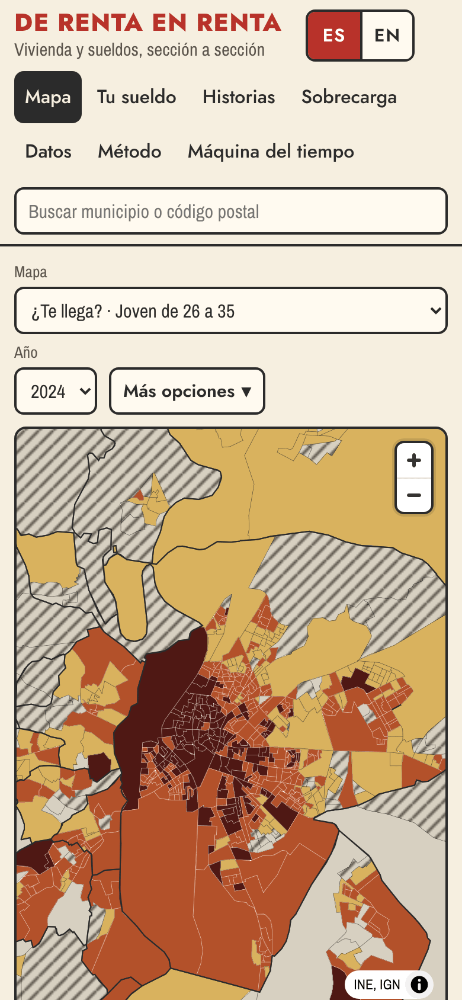</p>

Todo cabe en una columna. La barra se pliega en «Más opciones»; el mapa se mueve con dos dedos, para que uno solo desplace la página; la ficha y «Tu sueldo» van debajo del mapa. Con una historia abierta, el mapa se queda arriba y el paso justo debajo, con los botones a la vista.

</details>

## 6. Reglas de la casa

1. **Quedarse y entrar no se mezclan.** Ninguna cifra combina contratos vigentes y precios de oferta; cuando aparecen juntos, cada uno lleva su nombre.
2. **Ingresos netos, en 12 pagas.** Si el alquiler se dividiera entre una de las 14 pagas de un sueldo, su peso saldría inflado en torno a un 17 %.
3. **El umbral es una convención.** El 30 % (o el 40 %) solo cuenta el alquiler, salvo que añadas los otros gastos. La misma proporción deja mucho menos margen a un sueldo bajo que a uno alto.
4. **El sueldo necesario va siempre con dos cifras.** En 2024, en la sección mediana, 1.900 € netos al mes con el alquiler real y 1.217 € como mínimo con un piso de 50 m². Los pisos alquilados miden unos 79 m² de mediana.
5. **Cada indicador, en su escala.** Nunca se reparte una cifra provincial entre secciones ni se suman medianas.
6. **Mismo año arriba y abajo.** Alquiler e ingreso son del mismo año; si no puede ser (el salario mínimo del año en curso), se avisa.
7. **Cada cifra dice cuánto pesa.** Contratos detrás de cada mediana y margen aproximado; con menos de 30 contratos, la cifra es orientativa y su variación anual no se interpreta.
8. **Cuatro estados**: dato, estimado (reconstruido con una regla escrita), secreto estadístico y sin dato.
9. **Geografía fija.** Todas las series se llevan a las secciones de 2021, para comparar años sin que cambien los límites.
10. **Euros de cada año**, salvo donde se elige lo contrario (la evolución de la ficha y la máquina del tiempo).
11. **Lo que no cuadra no sale.** Más de 250 comprobaciones contrastan el pipeline con las cifras que publican las fuentes y consigo mismo; si falla una de bloqueo, no se publica.

## 7. Lo que el tablero no ve

- **El SERPAVI** sale de las declaraciones del IRPF de los caseros que son personas físicas: no recoge viviendas de sociedades, alquileres entre parientes ni alquiler no declarado. Mide el parque alquilado, no lo que paga quien entra. En 2024 tiene dato el 72 % de las secciones, donde vive en torno al 83 % de la población. En Navarra hay dato desde 2021; en Gipuzkoa, desde 2022; en Álava y Bizkaia, solo de 2024.
- **La renta de los hogares** es la de todos los hogares de la sección, propietarios incluidos, no la de quienes alquilan.
- **Los salarios de Hacienda** son lo cobrado en el año, también por quien trabajó pocos meses, y no cubren País Vasco ni Navarra.
- **«Lo que queda»** es una resta: ingreso menos alquiler. No dice si alcanza para vivir.
- **Va uno o dos años por detrás.** La renta y el alquiler llegan a 2024; los salarios y las pensiones, a 2025.
- **La sobrecarga** es una encuesta: muestra, no registro, y cuenta personas, no hogares.

Las cautelas completas, en el [«Método en dos páginas»](https://gastiaso.github.io/de-renta-en-renta/metodo_corto.html) y en la [nota metodológica](https://gastiaso.github.io/de-renta-en-renta/metodo.html).

## 8. Casillas en obras

- **«Entrar»**: la oferta de Idealista por municipio y lo que cuesta entrar frente a quedarse. El pipeline la tiene preparada como capa desmontable y apagada; sale cuando Idealista lo autorice por escrito, y nunca irá en las descargas.
- **«Reglas del juego»**: resúmenes de las normas estatales del alquiler y la compra, con sus artículos del BOE consolidado. Las casillas «Ley de Vivienda», «Actualización de la renta», «Aval de tus padres» y «Comunidad y derramas» ya llevan a la página, pero los resúmenes son provisionales: hasta su revisión jurídica, solo se publican sus títulos.
- **«Parque público»** (vivienda protegida), **«Notaría»** y **«Herencia»**: casillas rayadas del tablero.

## 9. Para jugar con los datos

Todas las cifras que pasan la compuerta están en una tabla larga, con una fila por territorio, año, indicador y desglose:

```
geo_id | nivel | anio | indicador | corte | grupo | valor | estado | fuente | geo_ref | version
```

| Fichero | Contenido |
|---|---|
| [`tabla_larga.parquet`](https://gastiaso.github.io/de-renta-en-renta/descargas/tabla_larga.parquet) | Los indicadores, de la sección a España |
| [`historico.parquet`](https://gastiaso.github.io/de-renta-en-renta/descargas/historico.parquet) | Las series de la máquina del tiempo |
| [`version.json`](https://gastiaso.github.io/de-renta-en-renta/descargas/version.json) | Fecha, commit, cobertura por indicador, licencias y sumas SHA-256 |
| [Release `v1.2.0`](https://github.com/gastiaso/de-renta-en-renta/releases/tag/v1.2.0) | Lo anterior, los datos de la web y el mapa base, con `SHA256SUMS` |

```r
library(arrow); library(dplyr)
alquiler <- open_dataset("tabla_larga.parquet") |>
  filter(indicador == "alquiler_m2", nivel == "municipio", anio == 2024,
         corte == "tipologia", grupo == "VC") |>
  collect()
```

```python
import pandas as pd
alquiler = pd.read_parquet("tabla_larga.parquet", filters=[
    ("indicador", "==", "alquiler_m2"), ("nivel", "==", "municipio"), ("anio", "==", 2024),
    ("corte", "==", "tipologia"), ("grupo", "==", "VC")])
```

Modelo de datos, valores de cada columna y diccionario de indicadores: página [«Datos»](https://gastiaso.github.io/de-renta-en-renta/datos.html). La oferta de los portales no está en ninguna descarga.

## 10. Debajo del tablero

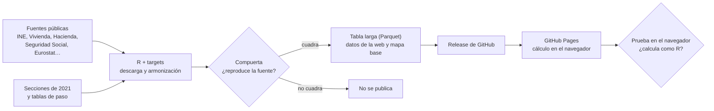

- **Pipeline en R** con [`targets`](https://docs.ropensci.org/targets/): una función por fuente y paso, decisiones en CSV (`inventario/`) y no en el código.
- **Geografía constante**: cada año se lleva a las secciones de 2021 con tablas de paso (callejero del INE donde las secciones caen enteras; edificios del Catastro donde hay que repartir).
- **Compuerta** (`inventario/referencias_validacion.csv`): las comprobaciones de bloqueo paran el pipeline; las de alerta avisan.
- **Web sin servidor**: HTML y JavaScript sin compilar, [MapLibre](https://maplibre.org/) con [PMTiles](https://docs.protomaps.com/pmtiles/) para las secciones y gráficos en SVG propio; sin cookies ni analítica (GitHub Pages, que la aloja, puede registrar qué ficheros se descargan). Una prueba recalcula en un navegador sin pantalla una muestra de cifras y las compara con R.
- **Identidad**: tablero propio inspirado en *The Landlord's Game* (Lizzie Magie, 1904), de dominio público; colores con contraste calculado y rampa comprobada con daltonismo simulado ([`diseno/`](diseno/)).

### Montar tu propio tablero

Hace falta R 4.6.1 (con `renv`), GDAL 3.8 o posterior con el controlador PMTiles, Node 18 o posterior, unos 12 GB de disco y 16 GB de memoria. Desde la carpeta del proyecto:

```r
renv::restore()                          # la primera vez: las versiones de renv.lock
source("R/brutos_comprobar.R"); brutos_informe()   # qué falta en datos/brutos/ (no descarga nada)
targets::tar_make()                      # descarga, calcula y pasa la compuerta
testthat::test_dir("pruebas/testthat")
```

Desde cero se bajan unos 9,6 GB. Tres fuentes no se dejan descargar de forma automática (SERPAVI, Registradores y las unidades del IGN): `tar_make()` se detiene y dice qué bajar y con qué nombre. Una pasada completa para toda España tarda unas tres horas y media; con `PROVINCIA=28` en el entorno se limita a una provincia. La guía paso a paso, en [`docs/reproducir.md`](docs/reproducir.md). Para ver la web:

```sh
node web/servir.mjs                      # http://localhost:8000
```

Sin datos del pipeline, la web carga una muestra con valores **inventados** del distrito Centro de Madrid, rotulada «Datos de ejemplo». Para verla con los datos publicados sin correr el pipeline, descomprime `datos_web.tar.gz` del último release dentro de `web/` y copia `seccionado_2021.pmtiles` en `web/teselas/`.

Más documentación: [nota metodológica](docs/metodologia.md) · [método en dos páginas](docs/metodo_corto.md) · [datos](docs/datos.md) · [reproducir desde cero](docs/reproducir.md) · [actualización de las fuentes](docs/actualizacion.md) · [publicación](docs/publicacion.md) · [web](web/LEEME.md) · [diseño](diseno/LEEME.md) · [cómo contribuir](CONTRIBUTING.md).

## 11. Fuentes

| Qué | Fuente |
|---|---|
| Renta de los hogares por sección | INE, Atlas de Distribución de Renta de los Hogares |
| Alquiler por sección | Ministerio de Vivienda y Agenda Urbana, Sistema Estatal de Referencia del Precio del Alquiler de Vivienda (SERPAVI) |
| Salarios y pensiones | Agencia Tributaria, *Mercado de trabajo y pensiones en las fuentes tributarias*; Seguridad Social, pensiones contributivas |
| Salario mínimo | BOE, real decreto de cada año |
| Variación del alquiler, hogares en alquiler, viviendas turísticas, hipotecas e IPC | INE |
| Compraventa | Colegio de Registradores (ODbL); valor tasado, Ministerio de Vivienda |
| Zonas tensionadas | Declaraciones publicadas en el BOE y por las comunidades autónomas |
| Geografía | INE (secciones, callejero y padrón), IGN, Catastro y catastros forales |
| Sobrecarga y acceso | INE, Encuesta de Condiciones de Vida (microdatos y módulo de 2025); Eurostat; geometrías GISCO |
| Máquina del tiempo | Banco de España, Ministerio de Vivienda, INE y CIS |

Lista completa, con la licencia y la cadencia de cada fuente: [`inventario/fuentes.csv`](inventario/fuentes.csv).

## Cómo citar

> Astiaso Llamazares, G. (2026). *De renta en renta: atlas de vivienda y salarios por sección censal* [software y datos]. https://gastiaso.github.io/de-renta-en-renta/. CC BY-SA 4.0. Origen de los datos: [fuente original].

Añade la fecha de los datos (aparece bajo el mapa) y la fecha de consulta. Las cifras de Registradores (precio de compraventa) llevan ODbL 1.0 en lugar de CC BY-SA 4.0.

GitHub ofrece la cita en otros formatos (APA, BibTeX) desde el botón *Cite this repository*.

## Licencias

- **Código:** [MIT](LICENSE).
- **Datos derivados, textos e inventario:** [CC BY-SA 4.0](https://creativecommons.org/licenses/by-sa/4.0/deed.es). Se pueden reutilizar con cualquier fin citando la autoría y publicando lo que se derive con la misma licencia.
- **Precio de compraventa (Registradores):** [ODbL 1.0](https://opendatacommons.org/licenses/odbl/1-0/).
- **Geometrías europeas (GISCO):** uso no comercial, con el aviso «© EuroGeographics para los límites administrativos».
- **Datos de origen:** las condiciones de cada fuente, que se cita también.
- **Oferta de los portales:** no se redistribuye.

Detalle en [`LICENCIA_DATOS.md`](LICENCIA_DATOS.md). El proyecto no tiene financiación, publicidad ni patrocinio, y ninguna de las fuentes lo respalda.

## Contacto

Errores, dudas o fuentes mejores: abre una [incidencia](https://github.com/gastiaso/de-renta-en-renta/issues) con el indicador, el territorio, el año y la fuente con la que comparas, o escribe por [LinkedIn](https://www.linkedin.com/in/guillermo-astiaso). Las correcciones van a la fe de erratas y al [registro de cambios](CHANGELOG.md).

## Proyectos relacionados

- [Barómetro a barómetro](https://github.com/gastiaso/barometros): las series de los barómetros mensuales del CIS desde 2021, calculadas desde los microdatos.
- [Historias con los barómetros del CIS](https://github.com/gastiaso/historias): entre ellas, cómo la vivienda se convirtió en el primer problema de España.
- [ineAtlas](https://github.com/pablogguz/ineAtlas), de Pablo García Guzmán: los datos del Atlas de Distribución de Renta de los Hogares desde R.
- [mapSpain](https://github.com/rOpenSpain/mapSpain), de rOpenSpain: límites administrativos de España para R.

*English version: [README.en.md](README.en.md).*
